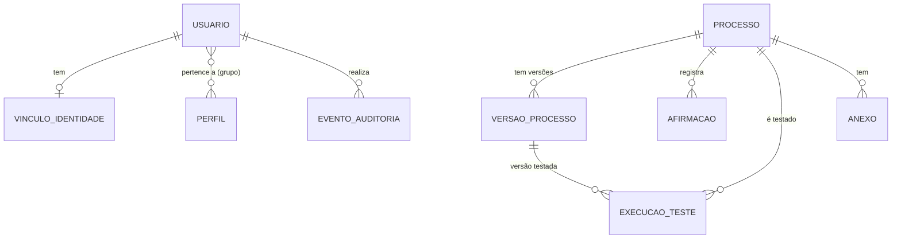

# Modelo de dados

Implementado agora: **identidade, auditoria e base de processos**. O restante é proposta,
a ajustar quando as amostras do SET chegarem. Valores em `Decimal`; datas gravadas em UTC
e exibidas em America/Sao_Paulo.

## Implementado

| Entidade | Pontos principais | Invariantes |
|---|---|---|
| VinculoIdentidade | origem (local provisória / intranet), identificador externo, desligado_em | identificador externo único por origem |
| EventoAuditoria | quem, quando, ação, recurso, resultado, correlação, IP, antes/depois, motivo | somente inclusão (ORM + gatilho PostgreSQL); campos sensíveis omitidos |
| Processo | título, área, criticidade, estado, titular, substituto, fonte, prazo, versão atual, versão validada | validado ⇒ tem validador e versão validada; título único por área |
| VersaoProcesso | campos do procedimento (seção 5 do briefing), autor, resumo da mudança | imutável; número único por processo; edição concorrente recusada |
| Afirmacao | declaração / observação / regra, fonte | regra ⇒ aprovada por alguém com permissão |
| ExecucaoTeste | executor, versão, resultado, “usou só a documentação”, dificuldades | executor ≠ autor da versão e ≠ titular |
| Anexo | nome original, tipo, tamanho, SHA-256 | sem duplicidade por processo; imagem de pessoa ⇒ autorização |

## Proposto para as próximas fases

| Módulo | Entidades | Regras que o modelo precisa garantir |
|---|---|---|
| Catálogo | Produto (SKU interno estável), Variante, Unidade e conversão, Localização, Fornecedor, ProdutoFornecedor, MapeamentoExterno (SET, Nuvemshop, Bling) | SKU único; mapeamento explícito, nunca por nome parecido |
| Importação | ArquivoImportado (hash, origem, usuário, período, horário de corte, versão do mapeamento), LoteImportacao (estado), LinhaPreparada (dados brutos, erros, quarentena) | importação concorrente bloqueada; chave de negócio evita duplicar venda em períodos sobrepostos; publicação parcial só autorizada e sinalizada |
| Vendas | DocumentoVenda e ItemVenda (quando o relatório trouxer), com chave de negócio da origem | cancelamento e reenvio tratados por regra, não por apagar |
| Estoque | SnapshotEstoque (origem, instante de corte, linhas por SKU e local), Movimentacao (tipo, motivo, documento, usuário), Reserva, Saldo por tipo (físico, reservado, disponível, danificado, consignado, em trânsito, destinado ao site) | snapshot é fotografia, não entrada; venda já incluída no snapshot não é descontada de novo; ajuste exige motivo; reserva nunca negativa |
| Reposição | PoliticaReposicao (mínimo, máximo, prazo, lote, múltiplo, segurança), Sugestao (dados usados, data de corte, confiança, decisão humana) | sugestão reproduzível; ajuste humano não sobrescrito sem controle |
| Compras | SolicitacaoCotacao e item, RespostaFornecedor, Aprovacao (alçada), PedidoCompra e item, Recebimento e item, PendenciaDocumental | pedido aprovado não muda sem nova aprovação; recebimento duplicado bloqueado |
| Finanças | LancamentoFinanceiro (origem, competência, vencimento, valor, status), CustoProduto com vigência | custo histórico não muda quando o fornecedor altera preço |
| Alertas | Alerta (tipo, gravidade, chave de deduplicação, responsável, estado), EntregaMensagem (canal, tentativas, estado) | uma condição contínua gera um alerta, não dezenas |
| Integrações | JobIntegracao (fila persistente, idempotência, tentativas), Execucao de agendamento | um job por chave de idempotência; trava contra execução simultânea |
| Backup | ExecucaoBackup, TesteRestauracao | mostrar a última restauração testada |
